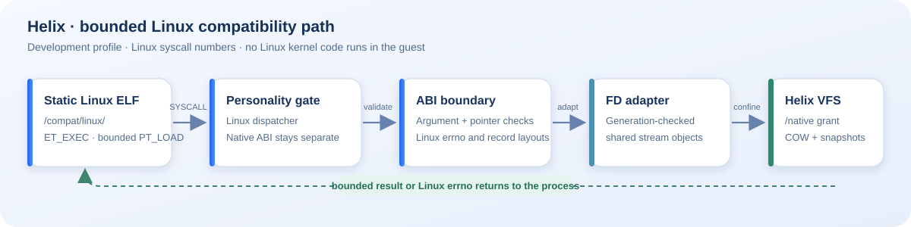

# Linux development profile



The recorded development profiles support an explicitly selected static x86-64 Linux ELF profile. Only `/compat/linux/` paths select this dispatcher. Native syscall entry is rejected for Linux processes, and native processes cannot select Linux behavior through numeric collisions. No Linux kernel code runs in the guest.

The loader accepts the bounded fixed ET_EXEC/PT_LOAD profile and constructs a minimal initial stack. PT_INTERP, dynamic linking and unsupported mandatory executable records reject. Implemented calls include stdout/stderr `write`, profile-gated `getpid`, bounded `uname`, `yield`, `exit`/`exit_group`, bounded `brk`/private-anonymous `mmap`/`munmap`, monotonic/realtime `clock_gettime`, `nanosleep`, and a bounded descriptor adapter for `openat`, `read`, `write`, `close`, `fstat`, `getdents64`, `lseek`, `dup`, `pread64`, `pwrite64`, `getcwd`, and `chdir`. `uname` reports `Linux`, node `next`, and a scoped Helix compatibility-personality release/version. Unknown calls return `ENOSYS`. Pointer, descriptor, mapping/protection, seek, and timespec errors have focused contract coverage. Anonymous mappings have a 64-page arena and enforce W^X; `brk` stays within the bounded process image region. There is no general libc, signal restart, dynamic/language TLS or VDSO implementation. The f42210 guest adds bounded FS/GS `arch_prctl` with separate process ownership and overlapping original TLS fixtures; user FSGSBASE remains disabled.

Original `hello.elf`, `clock.elf`, `memory.elf`, `getpid.elf`, `lseek.elf`, `fstat.elf`, `getdents.elf`, and `cwd.elf` run as identical binaries on host Linux and Helix; the `uname.elf` guest fixture checks the compatibility personality's exact six-field value and error handling. Existing gate fixtures check personality isolation. The fixtures use exact exit statuses and check both successes and selected errors. See [milestone evidence](evidence/README.md) for commands and image hashes. This does not establish unmodified general Linux software or a substantial application support catalog.

The original `getpid.elf` invokes syscall 39 twice and requires a stable positive identity while preserving a general-purpose register. `uname.elf` checks all 390 bytes of the six fixed 65-byte fields, including NUL padding, then requires `EFAULT` for a nonmapped destination. `lseek.elf` creates a scratch file, seeks and reads at explicit positions, checks that a negative resulting position, invalid `whence`, and invalid descriptor return their expected errors, and verifies rejected seeks do not move the shared cursor. `tools/build-linux.sh` also executes the getpid and lseek originals on host Linux; the complete guest suite runs through the standard signed build and QEMU boot-smoke workflow. The uname fixture is guest-specific because its required node, release, and version fields intentionally identify this scoped Helix personality.

The bounded syscall 5 `fstat` implementation writes the Linux x86-64 144-byte `struct stat` layout: `st_dev` at 0, `st_ino` at 8, `st_nlink` at 16, 32-bit `st_mode`/`st_uid`/`st_gid` at 24/28/32, padding at 36, `st_rdev` at 40, signed `st_size`/`st_blksize`/`st_blocks` at 48/56/64, timestamp pairs at 72/88/104, and three reserved 64-bit words at 120. Regular files use a synthetic device namespace distinct from character streams. It reports inode identity, link count (one while named, zero for a retained open inode after unlink or replacement), regular-file type/mode, UID/GID, size, block size and block count for bounded files; all timestamps, ABI padding and reserved words are zero. The EOF-only stdin models `/dev/null` (`S_IFCHR`, `st_rdev=259`, size zero); stdout and stderr are synthetic character streams. Closed or unknown descriptors return `EBADF`; a valid descriptor with an invalid 144-byte destination returns `EFAULT`, and an invalid descriptor takes precedence when both arguments are invalid. These values do not represent host ownership, permissions, timestamps, or a mounted POSIX filesystem. `fstat.elf` checks regular-file identity/type/size, duplicate identity, `/dev/null` type/size, `EBADF`, `EFAULT`, and no copyout on descriptor failure on both host Linux and the guest. Syscall 5 truncates the descriptor register to the Linux unsigned-int low 32 bits. The identical fixture also checks a valid descriptor with a 144-byte destination crossing into an unmapped page returns EFAULT. Only when uname reports the exact `1.0-next-linux-abi` release does it additionally require the mapped 64-byte prefix remain untouched: Helix validates the full destination before copyout, while host Linux may partially copy on EFAULT. The 2026-10-12 signed qemu64 run passed this fixture with exit54; see the [source-bound report](evidence/milestones/runtime-prism-2026-10-12/fstat-getdents-files-r3/).

## Descriptor adapter work

A bounded Linux integer-descriptor namespace now adapts shared native stream objects. Original static `file.elf` and its native-gate rejection counterpart execute open/read/write/seek/stat/dup/close workflows in Helix; the same primary fixture also runs on host Linux. Fresh image reports identify these additions separately from the older 03d541 milestone. Descriptors 0–2 retain the explicitly documented stdio behavior; ordinary descriptor numbers start at 3 and may be reused after close. Their underlying objects retain generation-checked identity. Each process has eight ordinary descriptors, and opens require an explicit console-launch grant under `/native/`. The adapter accepts the documented read/write modes and bounded create/exclusive/truncate/append/close-on-exec flag subset, requires creation mode 0600, reserves capacity before filesystem mutation, and reports unsupported flags. Duplicates share offset and rights; append seeks to EOF and restores offset after a failed write. fstat returns a bounded regular-file record; its development UID/GID fields are not a real credential service. Native capabilities remain distinct from Linux descriptor numbers.

The combined host model in `crates/helix-core/tests/descriptor_model.rs` tests 32 seeded sequences of 1000 operations against an independent namespace/content/offset model. It covers descriptor reservation/exhaustion, number reuse, duplicate object references, rights preservation, shared offsets, EOF/read tails, bounded seek/write holes, backend failure without cache/offset commit, and cleanup/reopen. A separate failure test checks capacity before mutation, reserved-slot rollback after failed truncation, immutable rights on rejected replacement and exclusive-open rejection. Run:

```sh
source tools/env.sh
cargo test --offline -p helix-core --test descriptor_model
cargo clippy --offline -p helix-core --test descriptor_model -- -D warnings
```

These tests exercise the exact core tables/streams, not the kernel's user-pointer validation or Linux errno mapping. Guest fixtures must separately verify invalid/unmapped buffers before offset consumption, open flags before create/truncate, access-mode errors, close/exit cleanup and namespace authority. [Compatibility validation](COMPATIBILITY-VALIDATION.md) gives the concrete adapter acceptance matrix.

The development profile adds shared inode content with independent open offsets, duplicate-shared offsets, and detached inode lifetime across unlink/rename replacement. The f42210 positive guest scenario exercises this inode lifetime; recorded milestone 418ea used exclusive bounded opens. COW whole-file replacement and this bounded inode model still lack arbitrary mounted VFS namespaces, links, concurrent/SMP writers, credentials, asynchronous I/O and full POSIX/NT semantics. Such unsupported semantics must be declared and rejected consistently. Dynamic linking, libc, signals, PTYs/job control, sockets/DNS/TLS, proc/sys namespaces, GUI bridges and exact real application workflows remain separate compatibility work.

The e96386bc05d5 development image adds CLOCK_REALTIME from the same immutable q35 RTC UTC anchor plus PIT elapsed time as the native clock. Unsupported/unavailable RTC is reported; there is no clock adjustment, timezone/NTP service or general RTC platform support. Monotonic timers retain their independent elapsed-time semantics.

## Bounded getdents64 source addition

Syscall 217 now enumerates read-only snapshots of the validated `/native` directory namespace. Directory opens require the existing explicit console-launch filesystem grant; `/native` itself and canonical descendants are supported, with `O_DIRECTORY` and the existing close-on-exec flag accepted. Host paths, symlinks and a general mounted POSIX namespace remain unsupported. Relative `openat`, `open`, `chdir` and `getcwd` behavior is described in the following section. The snapshot contains `.` and `..`, plus at most eight immediate journal children, in validated sorted order. Root `..` describes the confined `/native` root rather than granting access outside it. A separately opened directory gets an independent cursor; `dup` retains the same description and cursor. Closing the final reference or process teardown releases the snapshot. Namespace mutations after open do not refresh that snapshot.

The exact x86-64 `linux_dirent64` record has 64-bit `d_ino` at byte0, signed 64-bit next-cookie `d_off` at byte8, 16-bit `d_reclen` at byte16, `d_type` at byte18 and a NUL-terminated basename at byte19. Lengths are rounded to eight bytes; record padding is zero. `DT_DIR=4` and `DT_REG=8` reflect the checked backing namespace. Only whole records are returned. A count too short for the next record yields `EINVAL` without advancing; EOF yields zero. Raw syscall `fd` and `count` use their Linux unsigned-int low32 bits, including when the full register contains high bits. Non-EOF counts whose low32 value exceeds signed `INT_MAX` yield `EINVAL`, matching the Linux directory actor; at EOF there is no actor and even such a count yields zero without user-memory access. Per-call output is capped at4096 bytes. Cookies are bounded snapshot indexes, not filesystem byte offsets; `lseek(SEEK_SET)` accepts a valid snapshot cookie, and `SEEK_CUR` with offset0 reports the shared current cookie.

Invalid or closed descriptors yield `EBADF`; live regular/character streams yield `ENOTDIR`. User validation covers exactly the returned encoded bytes, not unused capacity. A buffer whose unused tail crosses an unmapped page can therefore succeed when every returned record fits. Invalid actual copyout yields `EFAULT` and leaves the shared cursor unchanged. The adapter releases its guard before copyout, then revalidates the generation-stamped directory description before committing the cursor. This runtime uses the existing single-CPU syscall context with interrupts masked; it does not establish SMP directory iteration semantics.

Directory `fstat` uses `S_IFDIR|0700`, synthetic device3, a deterministic path-derived synthetic inode, size0 and link count `2 + immediate subdirectories` from the retained snapshot. These directory/listing inode values are not persisted POSIX identities; regular-file dirent inode values are also synthetic path-derived values and do not claim equality with cached regular-file `fstat` inode IDs. Rename/unlink behavior for open directory snapshots, hard links and inode identity across directory moves remain limited accordingly.

`python3 tools/test-linux-fs-contract.py` exercises the actual adapter and serializer with host storage stubs: exact layout/padding/cookies, insufficient capacity, failed copyout without cursor consumption, lock release during copyout, duplicate-shared and independently opened cursors, directory stat/link count, permissions/confinement, regular-file type denial, descriptor exhaustion and teardown/reopen. The original assembly `getdents.elf` checks raw high-bit arguments, aligned/NUL-terminated records, `.`, `..`, shared EOF/rewind, independent open, invalid descriptors, `ENOTDIR`, `EINVAL`, `EFAULT`, and a short returned result despite an unmapped unused buffer tail. `tools/build-linux.sh` runs the same binary on host Linux with a temporary directory and requires exit55. The 2026-10-12 signed qemu64 run passed the guest fixture with exit55; its 128-check report and image hash are in the [source-bound evidence bundle](evidence/milestones/runtime-prism-2026-10-12/fstat-getdents-files-r3/). Directory listings remain open-time snapshots with synthetic path-derived inode values; this is not general live POSIX filesystem behavior.


## Working directory and confined relative open source addition

Raw x86-64 syscall79 `getcwd(output,size)` and syscall80 `chdir(path)` now use a bounded working directory owned by the process slot and generation. It initially names `/native`; another process has an independent cwd, and slot generation reuse resets it. `getcwd` returns the byte count including the terminating NUL, rather than a pointer. Insufficient capacity, including size0, returns `ERANGE` without copyout. A bad destination returns `EFAULT`; validation covers only the actual NUL-inclusive bytes. No adapter guard or owner reference spans user copyout.

Changing cwd and opening paths require the existing explicit development filesystem launch grant. `getcwd` does not confer filesystem authority. `chdir` commits the new cwd only after canonical path resolution and actual validated directory lookup succeed. Absolute and relative `open` paths are supported; `openat` uses the process cwd for `AT_FDCWD`, or the retained origin of a live directory descriptor for a relative path. At the raw ABI, dirfd is interpreted through its low32 bits: −100 selects `AT_FDCWD`, and ordinary nonnegative directory descriptor numbers resolve in that process's table. Absolute paths ignore dirfd, including an invalid descriptor. Relative paths with a closed/invalid dirfd return `EBADF`; live file or character descriptors return `ENOTDIR`.

Resolution is symlinkless and confined to `/native`. It canonicalizes repeated slashes, `.` and `..`, checks existing intermediate directories before removing an ancestry component, and refuses traversal above `/native` with `EACCES`. Thus `missing/../name` cannot bypass `ENOENT`, and `file/../name` cannot bypass `ENOTDIR`. A trailing slash requires a directory. Empty paths return `ENOENT`; unsupported name characters return `EINVAL`, and input or resulting paths longer than31 bytes return `ENAMETOOLONG`. The bounded C-string syscall reader checks each byte and its address addition before lookup. Relative rename/unlink are outside this addition and keep their prior absolute-path profile.

Cwd and directory-fd anchors retain the persisted folder identity and their canonical origin path. Before relative resolution or `getcwd`, Helix revalidates the origin against the current namespace. Removed, renamed or recreated origins return `ENOENT` instead of silently retargeting a reused name. Absolute `chdir('/native')` can recover from a stale cwd. This is a conservative identity-validation policy: it does not follow a renamed directory as a full POSIX inode-backed cwd would, and does not claim general mount, symlink, credential, chroot or SMP behavior. The immutable `/native` root uses its reserved identity; child identities come from the checked persisted directory metadata. Single-CPU syscall execution with interrupts masked keeps namespace validation and the subsequent operation ordered in this development profile.

Focused host contracts exercise independent cwd state and generation reset, ERANGE/EFAULT copyout preservation, canonical ancestry/error ordering, low32 dirfd behavior, relative descriptor origins, absolute-path dirfd independence, live character-stream type errors, and removed/recreated origin refusal. The original `cwd.elf` fixture was built for both host Linux and Helix; in the 2026-10-12 signed qemu64 run it printed its success marker and exited 56 after checking `getcwd`, `chdir`, error preservation, confinement, `AT_FDCWD`, and directory-fd-relative `openat`. The 134-check report and signed image hash are in the [source-bound cwd and Prism evidence bundle](evidence/milestones/runtime-prism-2026-10-12/cwd-copy-wave/). This remains fixture-scoped evidence, not broad POSIX compatibility.
