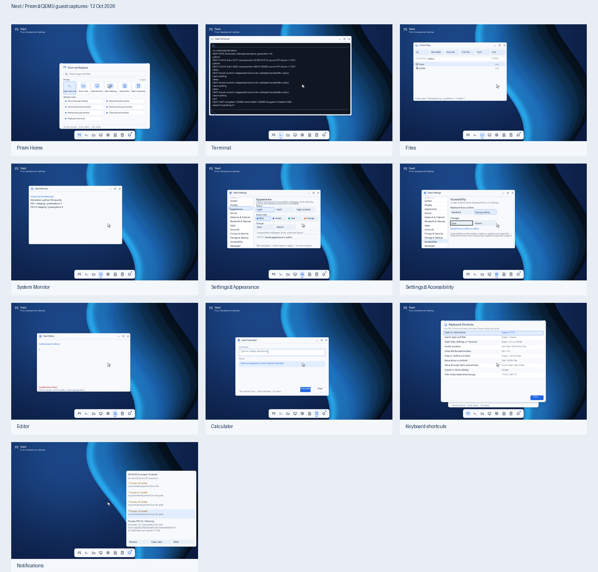
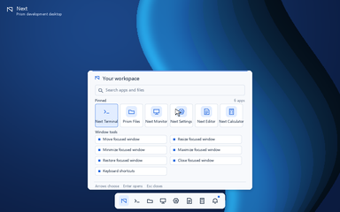
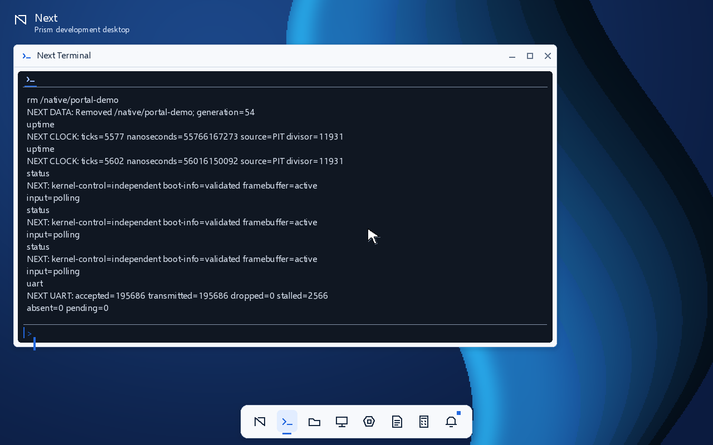
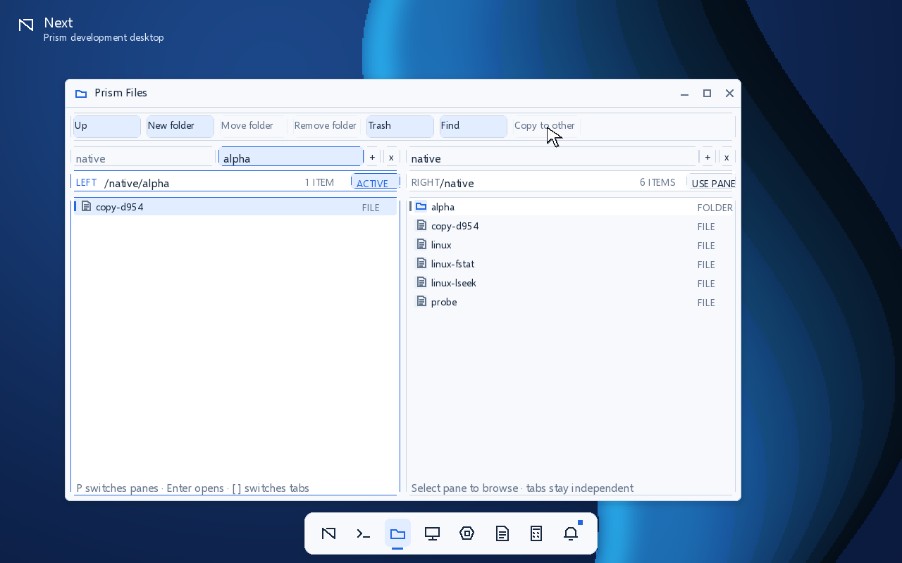
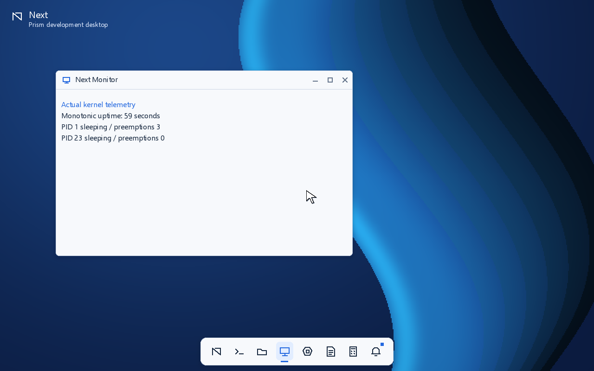
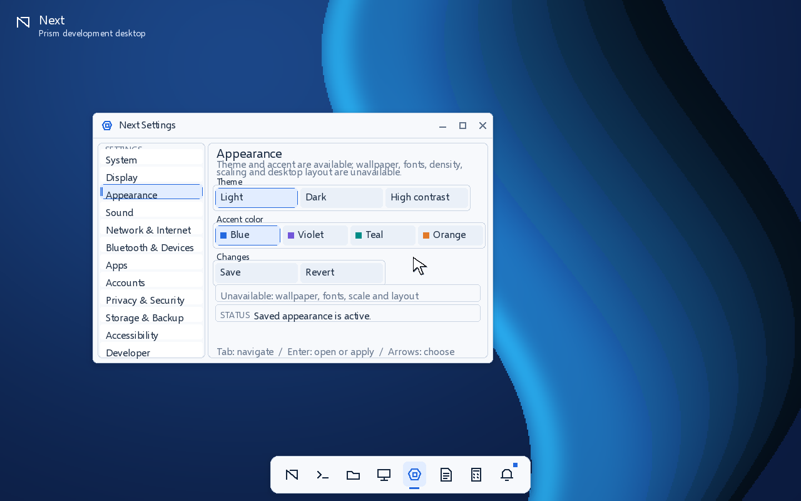
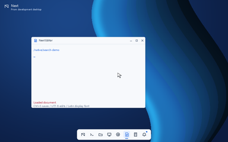
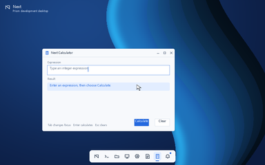
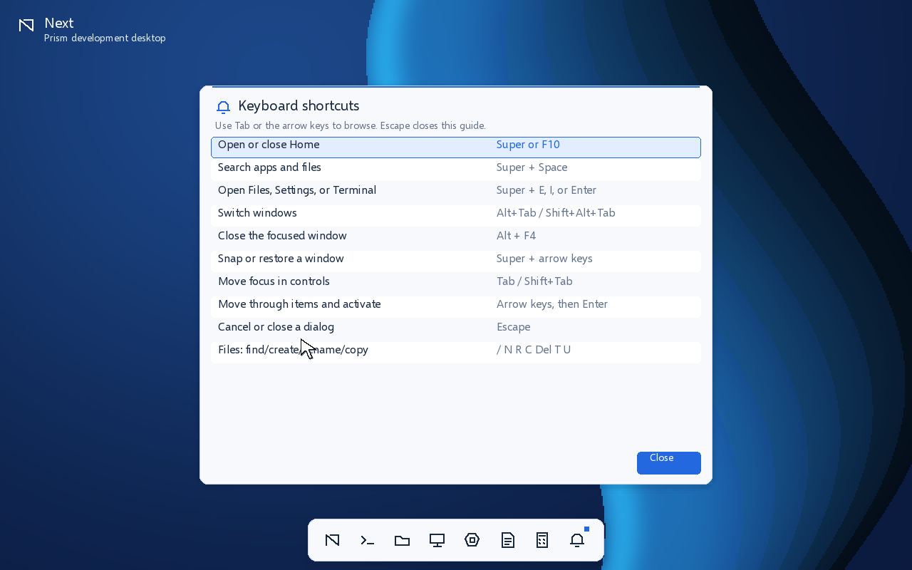
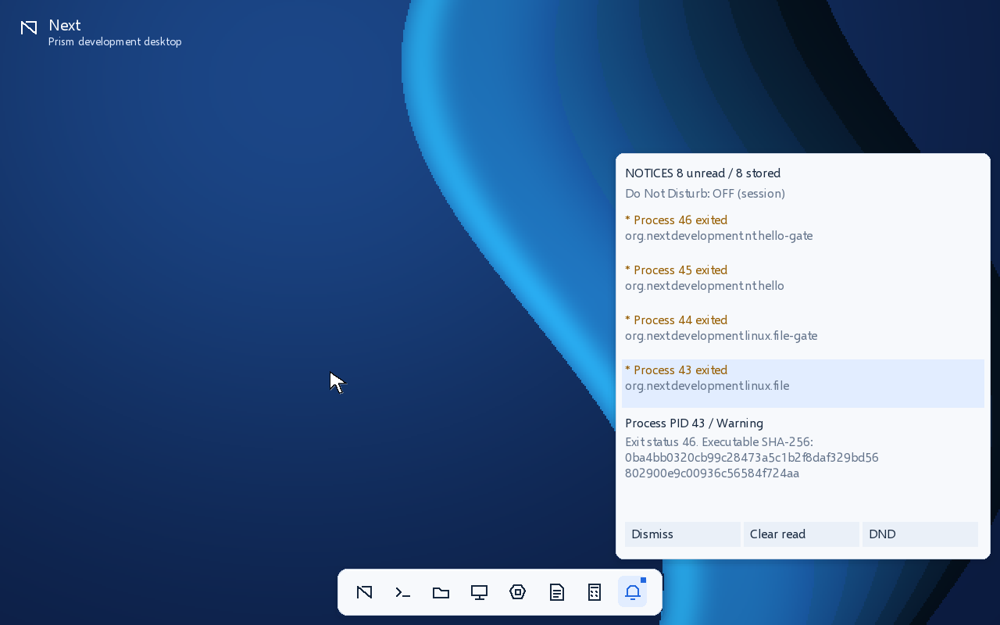

# Prism visual gallery

These screenshots come from completed framebuffer presentations in a running
q35/TCG/OVMF guest. The smoke harness launches or opens each view with QMP
keyboard input, captures the guest screen, and validates the image dimensions.
They document the current development build; they do not certify accessibility,
hardware display behavior, text shaping, or Next 1.0 completion. The exact
qemu64 run report and matching image hash are retained in the [runtime and Prism
evidence](evidence/milestones/runtime-prism-2026-10-12/).



Regenerate the source captures with:

```sh
source tools/env.sh
bash tools/build.sh
python3 tools/boot_smoke.py --timeout 240 --capture-prism-gallery
```

The gallery includes the current six kernel-hosted first-party panels, plus a
second Settings capture taken after saving the Accessibility focus-outline
choice. Settings has 12 navigable categories: Appearance has active
theme/accent controls and Save/Revert, Accessibility has the saved
Standard/Strong focus-outline choice, System offers read-only diagnostics, and
the other nine categories remain informational with unavailable settings rows.
The Accessibility frame shows the keyboard path, saved state, and rendered
outline; it does not establish the screen reader, speech, magnification, or
other controls that remain unavailable. The Calculator is an expression
utility rather than a complete scientific calculator.

## Home



## Terminal



## Files



## System Monitor



## Settings



## Settings Accessibility


## Editor



## Calculator



## Keyboard shortcuts



## Notifications


