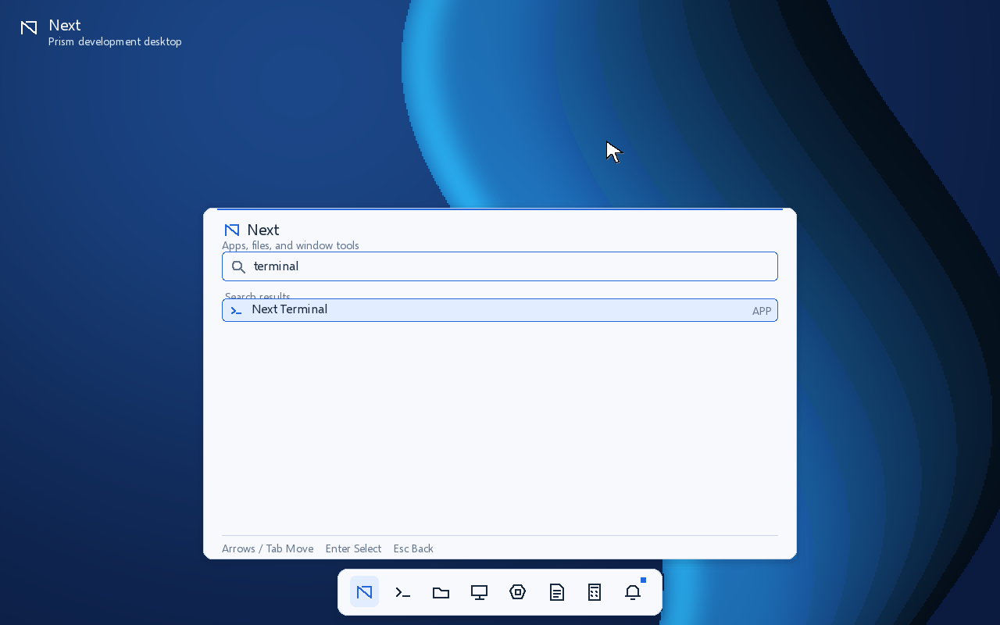
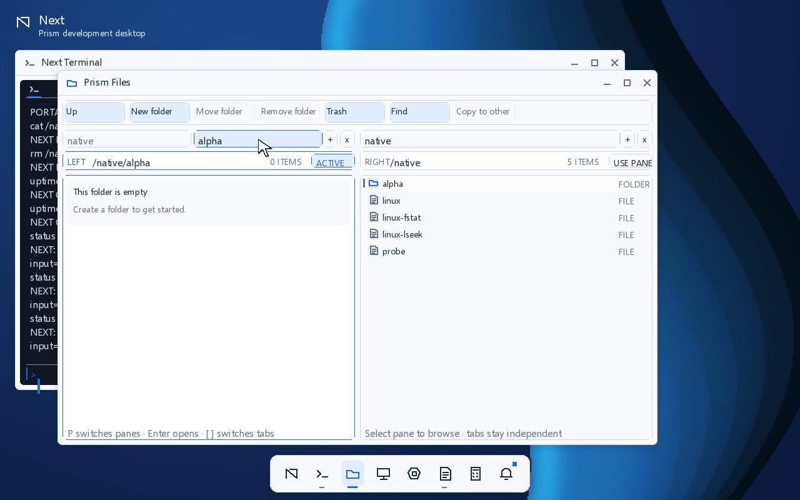
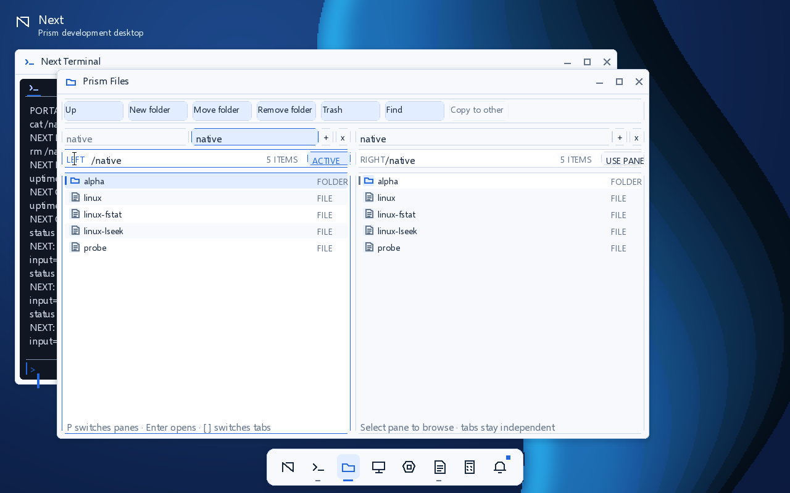
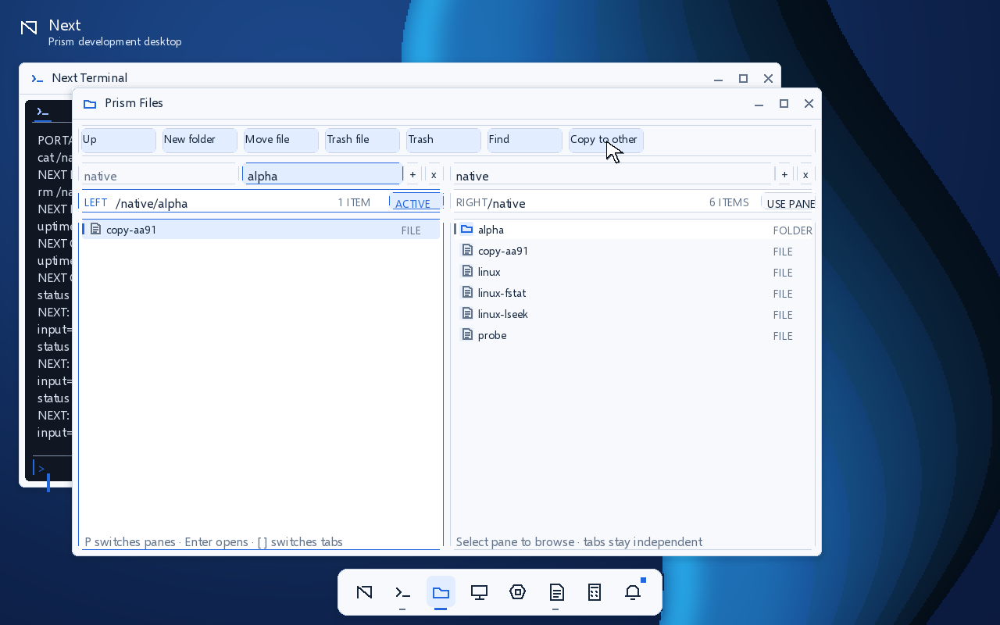
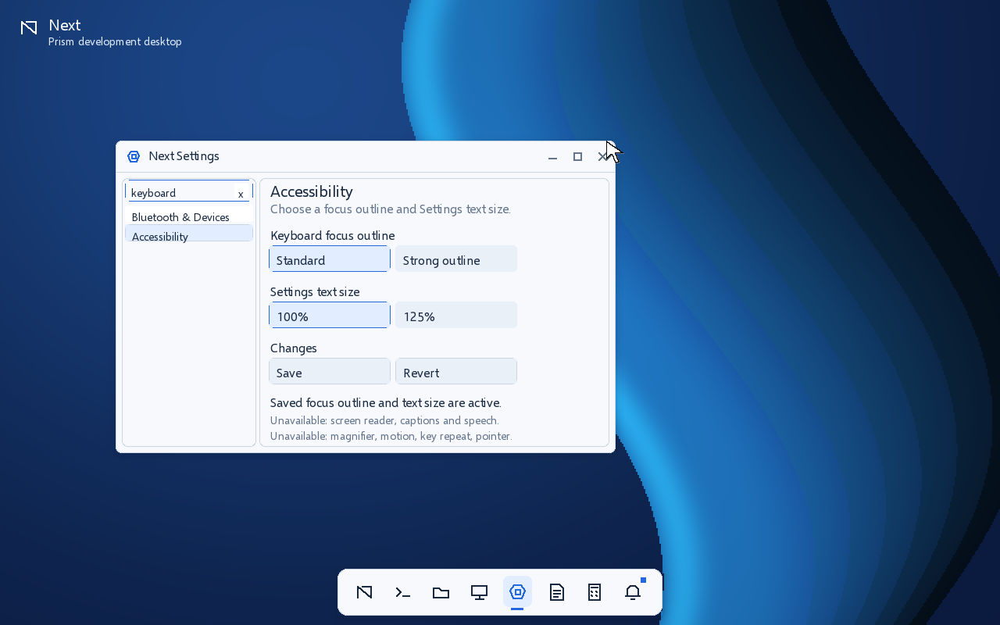
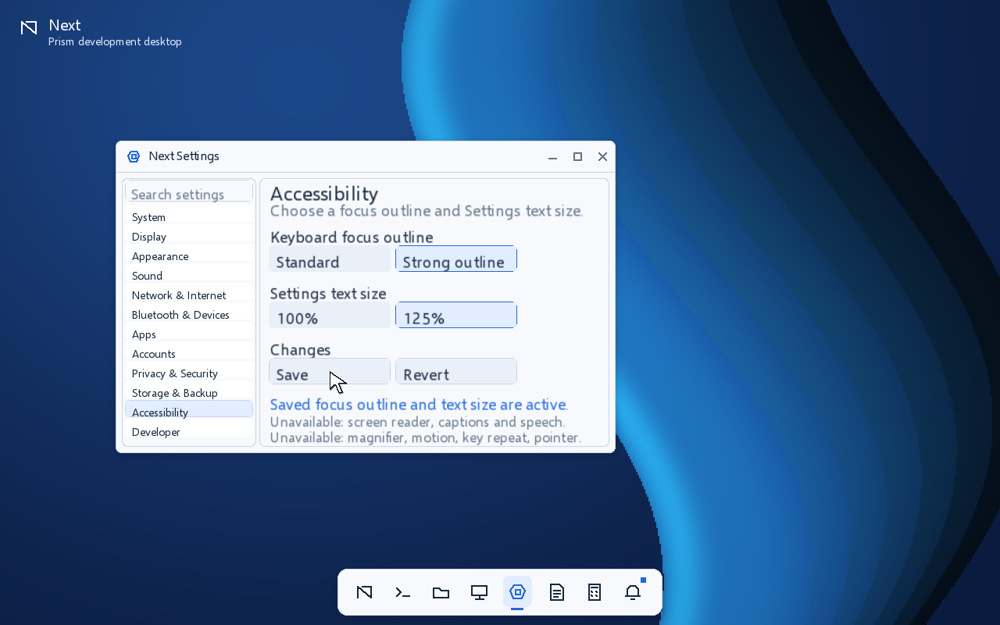
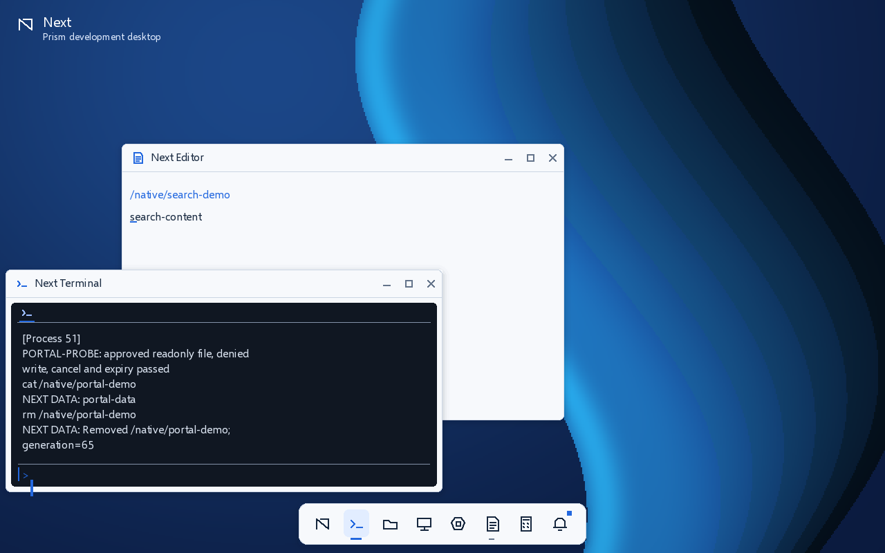

# Prism visual gallery

These twenty screenshots are current captures from completed framebuffer presentations in a running q35/TCG/OVMF guest. The QMP smoke checked Home search selections through the guest accessibility snapshot and validated each captured frame. The signed qemu64 development image passed 138 checks with SHA256 `64d07c2ff4b53c3e14dafdb23ed28b655bafc98eab9543fe099229910f302d10`. The [report](evidence/milestones/runtime-prism-2026-10-12/prism-linux-search-wave/boot-smoke.json) and [capture manifest](evidence/milestones/runtime-prism-2026-10-12/prism-linux-search-wave/capture-manifest.json) record this run. Later source changes need fresh captures before these pictures can represent them. They do not certify hardware display behavior, complex-script shaping, full accessibility services, or Next 1.0 completion.

Prism uses Microsoft Selawik, an open-source metric-compatible replacement for Segoe UI; it is not Segoe UI Variable. The raster atlas, provenance, and unsupported shaping limits are listed in the [font notices](third-party/README.md#font-assets).


Regenerate the source captures with:

```sh
source tools/env.sh
bash tools/build.sh
python3 tools/boot_smoke.py --cpu qemu64 --timeout 360 --capture-prism-gallery \
  --image build/next-dev.img --output-dir build/runtime-linux-search-timer-zero-qemu64-r10
```

The gallery includes six kernel-hosted first-party panels, Home and Settings search, saved Accessibility preferences, Settings-only 125% text size, the shortcut guide and Notifications. Settings has 12 categories: Appearance has active theme/accent controls and Save/Revert, Accessibility exposes two saved preferences, System offers read-only diagnostics, and nine categories remain informational with unavailable settings rows. Search result selection and shortcut-guide activation are checked through the guest's accessible tree. Text scaling applies only within Settings and does not establish screen reader, speech, magnification or other unavailable services. The four-way snap frame shows Terminal in the BottomLeft work-area quadrant with Editor behind it; snapping remains limited to the single current work area. Files captures cover root and nested tabs, the I-beam location cursor, independent panes and a verified cross-pane copy. The Linux `cwd.elf` fixture exits 56 after checking `getcwd`, `chdir` and relative `openat`; the Linux timefile fixture exits 57 after checking `gettimeofday` sequential copyout and `ftruncate` descriptor semantics. The Calculator is an expression utility, not a scientific calculator. These captures and checks do not imply that every Settings category or planned Prism feature is complete.

## Capture index

Each thumbnail links to its full-size QEMU capture.

<table>
  <tr>
    <td align="center"><a href="images/prism-home.png"></a><br><sub>Home</sub></td>
    <td align="center"><a href="images/prism-home-search-terminal.png"></a><br><sub>Home search</sub></td>
    <td align="center"><a href="images/prism-terminal.png"></a><br><sub>Terminal</sub></td>
    <td align="center"><a href="images/prism-files.png"></a><br><sub>Files</sub></td>
  </tr>
  <tr>
    <td align="center"><a href="images/prism-files-tabs-root.png"></a><br><sub>Files root tab</sub></td>
    <td align="center"><a href="images/prism-files-tabs-nested.png"></a><br><sub>Files nested tab</sub></td>
    <td align="center"><a href="images/prism-files-tabs-ibeam.png"></a><br><sub>Files location cursor</sub></td>
    <td align="center"><a href="images/prism-files-dual-pane.png"></a><br><sub>Files dual pane</sub></td>
  </tr>
  <tr>
    <td align="center"><a href="images/prism-files-copy-to-other-pane.png"></a><br><sub>Files cross-pane copy</sub></td>
    <td align="center"><a href="images/prism-settings.png"></a><br><sub>Settings Appearance</sub></td>
    <td align="center"><a href="images/prism-settings-search-keyboard.png"></a><br><sub>Settings search</sub></td>
    <td align="center"><a href="images/prism-settings-accessibility.png"></a><br><sub>Accessibility preferences</sub></td>
  </tr>
  <tr>
    <td align="center"><a href="images/prism-settings-text-scale.png"></a><br><sub>Settings text size</sub></td>
    <td align="center"><a href="images/prism-monitor.png"></a><br><sub>System Monitor</sub></td>
    <td align="center"><a href="images/prism-editor.png"></a><br><sub>Editor</sub></td>
    <td align="center"><a href="images/prism-calculator.png"></a><br><sub>Calculator</sub></td>
  </tr>
  <tr>
    <td align="center"><a href="images/prism-snap-quadrant.png"></a><br><sub>Quarter snap</sub></td>
    <td align="center"><a href="images/prism-shortcuts.png"></a><br><sub>Keyboard shortcuts</sub></td>
    <td align="center"><a href="images/prism-notifications.png"></a><br><sub>Notifications</sub></td>
    <td align="center"><a href="images/prism-home-search-calculation.png"></a><br><sub>Home arithmetic search</sub></td>
  </tr>
</table>

## Home


## Home search


## Home search arithmetic


Home search exposes this valid expression as a selectable result; Enter opens Calculator with the expression evaluated. The guest smoke checks the selected accessibility result and launch.

## Terminal


## Files


The following frames document separate Files tab views and cursor state.

### Files tabs: root view


### Files tabs: nested view


### Files location I-beam cursor


### Independent panes and cross-pane copy


The guest flow checks exact source and destination paths and confirms that both pane listings refresh after the commit.

## System Monitor


## Settings


## Settings search


## Settings Accessibility


## Settings text size


## Editor


## Calculator


## Keyboard shortcuts


## Notifications


## Quarter snapping


For a captioned walkthrough of these frames, see the [Prism visual tour](PRISM-VISUAL-TOUR.md).
