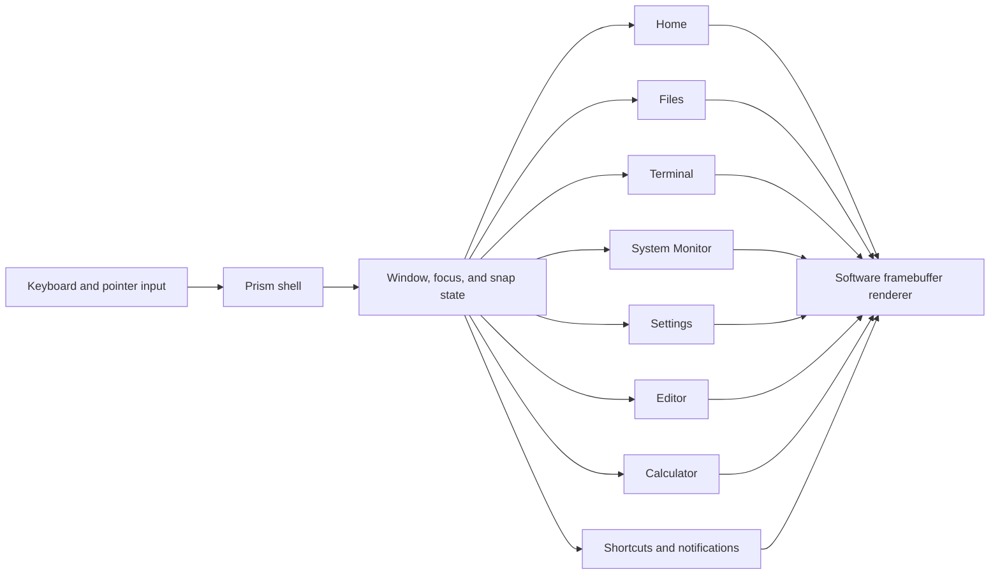
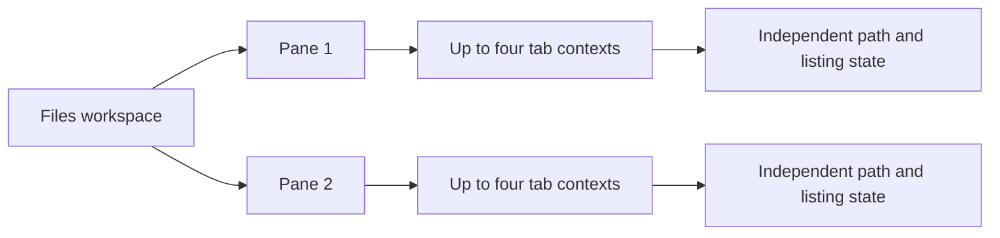
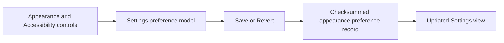

# Prism visual tour

These twenty current captures come from the signed qemu64 guest image, SHA-256
`6b245fa85c2c49ad1da63cf7d6fdfb813e3d351c3275217c736d7b1c43b1da15`. Its QEMU
smoke passed 138 checks. The [report](evidence/milestones/runtime-prism-2026-10-12/prism-clock-notifications-wave/boot-smoke.json)
and [capture manifest](evidence/milestones/runtime-prism-2026-10-12/prism-clock-notifications-wave/capture-manifest.json)
record the run. It checked Home and Settings search through the guest's
accessible tree, saved Settings states, Files tab and pane navigation,
cross-pane copy, Home arithmetic selection of `2+3*4 = 14`, and Linux
`clock_gettime`/`clock_getres` fixture runs. These are development-build
captures tied to that image. They do not imply Next 1.0 completion, hardware
validation, full accessibility services, or that every Settings category is
functional.

## Capture index

Each thumbnail links to its full-size QEMU capture.

<table>
  <tr>
    <td align="center"> Home</td>
    <td align="center"> Home search</td>
    <td align="center"> Terminal</td>
    <td align="center"> Files</td>
  </tr>
  <tr>
    <td align="center"> Files root tab</td>
    <td align="center"> Files nested tab</td>
    <td align="center"> Files location cursor</td>
    <td align="center"> Files dual pane</td>
  </tr>
  <tr>
    <td align="center"> Files cross-pane copy</td>
    <td align="center"> Settings Appearance</td>
    <td align="center"> Settings search</td>
    <td align="center"> Accessibility preferences</td>
  </tr>
  <tr>
    <td align="center"> Settings text size</td>
    <td align="center"> System Monitor</td>
    <td align="center"> Editor</td>
    <td align="center"> Calculator</td>
  </tr>
  <tr>
    <td align="center"> Quarter snap</td>
    <td align="center"> Keyboard shortcuts</td>
    <td align="center"> Notifications</td>
    <td align="center"> Home arithmetic search</td>
  </tr>
</table>

## Home search arithmetic

The guest selects the accessible `2+3*4 = 14` result. Enter opens Calculator with the expression evaluated; the gallery run checks the result selection and launch.

## Architecture schematics

These compact diagrams summarize the current implementation paths behind the
captured screens. They describe the bounded kernel-hosted development UI, not
the planned Next 1.0 compositor or service architecture.

### Desktop shell and panels

QEMU captures show these panels rendered in the guest; they do not show
separate userspace applications or a GPU compositor.

### Files panes and tab contexts

The QEMU flow creates a nested folder, switches between root and nested tabs,
checks the I-beam pixels, and navigates each pane while retaining the other
pane's path. The four-tab bound comes from the implementation model; this smoke
does not fill every tab slot.

The Copy to other pane action uses the existing authorized Inspect/Commit flow.
The guest report records the exact source/target pair and confirms that both
pane listings refresh after the commit.

### Settings preference path

The guest smoke confirms an accepted Settings Save action and captures the
Strong focus outline and 125% text-size states. Text scaling applies inside
Settings only. Host save/reload tests cover the preference record; these guest
screens do not establish screen-reader, magnification, speech, or other
assistive services.
